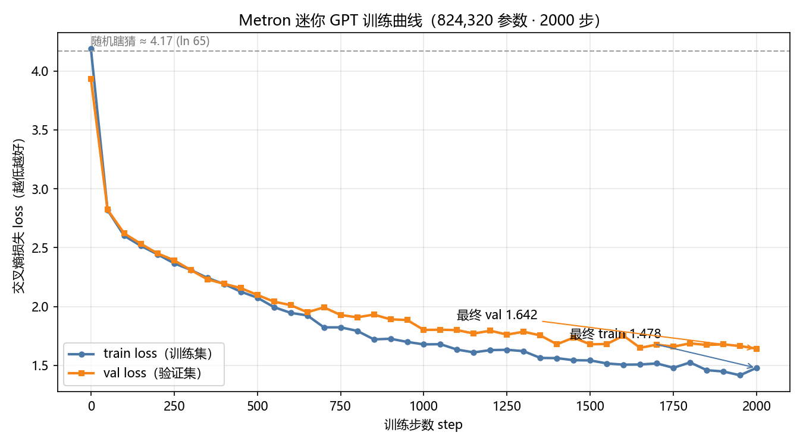
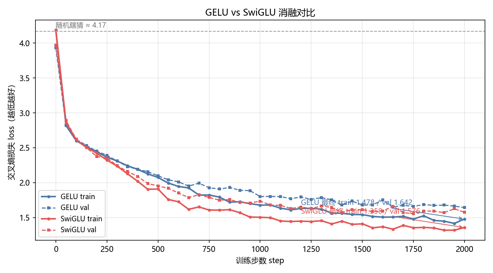
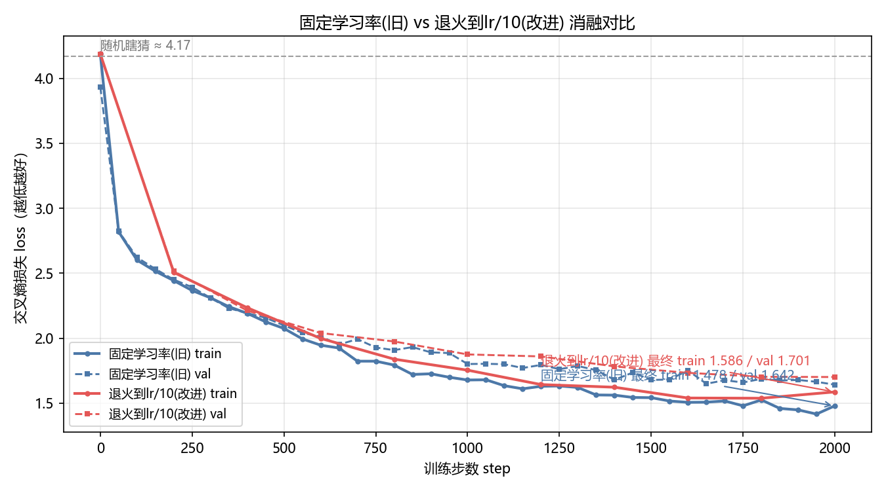

# llm-internals · 从零手写迷你 GPT（理解大模型底层原理）

> 不调用任何外部 AI API，在普通个人电脑上从零训练一个 **82 万参数**的字符级 GPT。
> 读懂它，就摸到了大模型的核心门道：**数据 → 模型 → 权重自动学习 → 生成**。

纯 Python ｜ PyTorch ｜ 824,320 参数 ｜ 2000 步可复现 ｜ MIT License

---

## 项目简介

本项目用 PyTorch **从零实现并训练**了一个字符级 GPT（生成式预训练 Transformer），全部核心组件手写，无任何现成 Transformer 库：

- **数据**：莎士比亚全集（1.1MB 纯文本，约 65,000 种字符片段，词表 65）
- **规模**：65 字符词表 × 128 维嵌入 × 4 层 × 4 注意力头
- **结果**：2000 步训练后 **train loss 1.48 / val loss 1.64**，可生成莎士比亚腔文本
- **成本**：普通个人电脑 CPU 训练约 15 分钟，零成本

模型学到的本质是"字符之间的统计规律"——什么字符经常挨着、什么词语常出现、什么句式像莎翁。**这就是大模型语言能力的最小可复现版本**，原理与 GPT-4 / DeepSeek 等大模型完全一致，只是规模放大了千万倍。

## 亮点

| 亮点 | 说明 |
|---|---|
| **从零手写** | 不使用 HuggingFace、不调 API，每个组件可逐行读 |
| **双激活可切换** | MLP 支持 GELU（经典）与 SwiGLU（现代大模型），`--activation` 一键对比 |
| **教学级注释** | model.py 每行中文注释，注释即教程 |
| **可复现** | 固定随机种子（1337），2000 步结果可精确复现 |
| **参数透视** | peek_weights.py 可查看训练前后权重变化 |
| **万物可学** | 换任意 .txt 语料即可重训（中文也支持） |

## 模型架构

```
输入字符序列 "ROMEO:"
        │
        ▼
┌──────────────────────────────────┐
│  字符嵌入表 65×128               │
│  + 位置嵌入表 128×128            │
└──────────────────────────────────┘
        │  x (B, T, 128)
        ▼
┌──────────────────────────────────┐
│  Block × 4 层                    │
│  ┌────────────────────────────┐ │
│  │ LayerNorm → 多头因果注意力   │ │
│  │      ↓ 残差连接 (+)         │ │
│  │ LayerNorm → MLP（GELU）     │ │
│  │      ↓ 残差连接 (+)         │ │
│  └────────────────────────────┘ │
└──────────────────────────────────┘
        │
        ▼
  LayerNorm → 输出头 (128→65)
        │
        ▼
  65 个字符的分数 → softmax → 预测下一个字符
```

### 参数构成（82 万 = 查表 + 接线板 + 旋钮）

| 模块 | 参数量 | 类比 |
|---|---:|---|
| 字符嵌入表（65×128） | 8,320 | 字符"长什么样" |
| 位置嵌入表（128×128） | 16,384 | 位置"长什么样" |
| 4 × Block（注意力 + MLP + 归一化） | 791,040 | "谁和谁挨着"的接线板 |
| 输出归一化 + 输出头 | 8,576 | 出口微调 + 打分 |
| **合计** | **824,320** | **≈ 82 万** |

### 核心组件（全部手写）

- **多头因果注意力**：字符间"横向交流"——只看左边，QKV 打分 → 掩码 → 概率 → 加权求和
- **LayerNorm**：归一化（减均值除标准差）+ 可学习的 γ/β 旋钮
- **残差连接**：信息抄近路 + 梯度回城高速，让深层网络可训练
- **MLP（GELU 激活）**：每个字符"纵向思考"，非线性让多层不白叠
- **温度采样**：推理时控制随机性（低=保守复读，高=胡言乱语）

## 训练效果

- 训练 2000 步：**train loss 1.4785 / val loss 1.6424**（实测，约 15 分钟）
- loss 含义：1.48 ≈ 平均每次预测有 23% 把握猜对下一个字符（随机瞎猜是 ln(65)≈4.17，即 1/65 概率）
- 生成效果：模型输出莎士比亚剧本风格文本（含角色名、对白分行）



> 曲线解读：train/val loss 从随机水平（≈4.17）一路下降——模型确实在学"字符规律"，不是背答案。

## 快速上手

```bash
# 1. 安装依赖（只需 PyTorch）
pip install torch

# 2. 训练（默认 2000 步，CPU 约 15 分钟）
python train.py

# 3. 生成一段文本（默认从 "ROMEO:" 开始）
python generate.py

# 4. 自定义生成
python generate.py --prompt "To be, or not" --length 300 --temperature 0.8
```

### 常用参数

**训练** `python train.py`

| 参数 | 说明 |
|---|---|
| `--max_iters 5000` | 训练更多步（更慢但效果更好） |
| `--n_layer 8` | 加深层数（权重的"层数"） |
| `--lr 3e-4` | 学习率 |
| `--activation swiglu` | 切换 MLP 激活函数（gelu 经典 / swiglu 现代大模型版） |
| `--log loss_log.csv` | 记录训练 loss 日志（`plot_loss.py` 画图用） |
| `--print_weights` | 训练完打印每一层权重张量 |

**生成** `python generate.py`

| 参数 | 说明 |
|---|---|
| `--prompt "..."` | 开头文字 |
| `--length 500` | 生成长度 |
| `--temperature 0.1` | 稳定 ／ `0.8` 适中 ／ `1.5` 疯狂 |

### 换个语料训练

把任意 `.txt` 文件复制为 `input.txt`（UTF-8 编码），重新运行 `python train.py` 即可 —— 这就是"万物皆可量化 / 万物皆可学"的第一步。

## 项目结构

```
llm-internals/
├── model.py          # 模型定义（教学级中文注释，注释即教程）
├── train.py          # 训练脚本：喂数据 → 自动学权重 → 保存模型（支持 --log 记录 loss）
├── generate.py       # 推理脚本：用训练好的模型生成文本
├── plot_loss.py      # 画图脚本：把训练日志画成 loss 曲线
├── peek_weights.py   # 透视脚本：查看训练前后权重变化
├── input.txt         # 训练语料（莎士比亚全集，1.1MB）
├── model.pt          # 训练好的权重（824,320 参数）
├── loss_log.csv      # 训练日志（step/train loss/val loss，画图用）
├── run_generate.bat  # Windows 一键生成（双击即可）
├── assets/           # README 配图（loss 曲线等）
├── 代码阅读指南.md    # 新手向的代码阅读指南
└── README.md         # 项目说明（本文件）
```

## 实验记录

> 持续更新中 —— 四个实验的进行状态：

- [x] **loss 曲线可视化**：`python train.py --log loss_log.csv --eval_interval 50` 记录日志 → `python plot_loss.py` 画图（见上方训练效果图）
- [x] **GELU vs SwiGLU 消融实验**：两版各训 2000 步，参数量基本持平（821,248 vs 824,320，差 0.4%），对比结论见下
- [x] **训练前后生成效果对比**：随机模型 vs 训练后模型（见下，完整文本在 `assets/before_train.txt` / `assets/after_train.txt`）
- [x] **学习率调度实验**：固定学习率 vs warmup+余弦退火，三版各训 2000 步，验证"调度威力在长训练"（见下）

### 实验 2：GELU vs SwiGLU 消融



| 版本 | 最终 train loss | 最终 val loss |
|---|---:|---:|
| GELU（经典，GPT-2/3） | 1.478 | 1.642 |
| **SwiGLU（现代，Llama/DeepSeek）** | **1.358** | **1.576** |

**结论**：在参数量基本持平（差 0.4%）的公平对比下，SwiGLU 训练与验证 loss 均更低（train −0.12，val −0.07），与业界"现代大模型选用 SwiGLU"的结论一致——门控结构让模型能自己学习"放多少信息通过"，表达力更强。

复现方法：
```bash
python train.py --log loss_log.csv          --save model.pt        # GELU 版
python train.py --activation swiglu --log loss_log_swiglu.csv --save model_swiglu.pt  # SwiGLU 版
python plot_loss.py --log loss_log.csv --log2 loss_log_swiglu.csv --name1 GELU --name2 SwiGLU --out assets/loss_compare.png
```

### 实验 3：训练前后生成效果对比

同一句话开头（`ROMEO:`）、同一种子、同一温度（0.8），生成 300 字符：

**训练前（随机初始化模型）—— 纯乱码：**
```
ROMEO:CpzlYaS ;czde.'wEiT,YVrzlGu-aYeNY
ijbo
LzRX$KULS-A.U'FisVJ'G HT,OPtW;,Ye$zOAnsz-imHzPAkfEfY:gS;RTNBE:myOzx. qVh -LLcJJlOHPXBvsLAofgSn
KqzMdXEIAgqgpoZvhA&Xn3z;SKGSqIaqvWr
...
```

**训练后（2000 步）—— 莎士比亚腔：**
```
ROMEO:
Why, hercheed we hence, sunse heart
That answer-body is bid with this base nothing cold
And hath ansmy more shall collowem's profe?

KING HENRY VI:
Marry paise to a virtuous to the perfort:
My little have the shing hearting her hate;
...
```

**结论**：训练前权重是随机数，模型"什么都不知道"，输出纯乱码；训练 2000 步后，82 万权重里存下了"什么字符经常挨着"的统计规律——有角色名、有对白分行、句子半通不通。**这就是大模型语言能力的诞生过程**。

复现方法：`python before_after_demo.py`（完整文本存于 `assets/before_train.txt` / `assets/after_train.txt`）

### 实验 4：学习率调度（warmup + 余弦退火）对比



同一个模型、同一份数据、同样的 2000 步，三种学习率策略：

| 策略 | 最终 train loss | 最终 val loss |
|---|---:|---:|
| 固定学习率（3e-4 全程） | 1.478 | **1.642** |
| warmup + 退火到 0（第一版） | 1.615 | 1.726 |
| warmup + 退火到 lr/10（改进版） | 1.586 | 1.701 |

**结论**（这个结论不是书上抄的，是三组真实训练数据跑出来的）：
- **退火不该退到 0**：退到 0 意味着后期学习率趋近于 0，模型完全停止学习，白白浪费步数（第一版 val 1.726 最差）；退到峰值的 1/10 明显更好（1.701）。
- **2000 步的小短跑里，固定学习率仍然略胜**：全程满速 3e-4 大踏步，在短训练里占便宜。
- **但改进版曲线末期没有饱和**（val 从 1.733 一路缓降到 1.701），固定版后期已经趋平震荡——**只要训练够长，学习率调度会翻盘**。这正是 GPT/Llama/DeepSeek 等大模型（动辄几万步）全部使用学习率调度的原因：**调度的威力在长训练才释放**。

复现方法：
```bash
python train.py --log loss_log.csv --save model.pt            # 固定学习率（旧）
python train.py --log loss_log_sched.csv --save model_sched.pt   # 第一版：退火到 0
python train.py --log loss_log_sched2.csv --save model_sched2.pt # 改进版：退火到 lr/10
python plot_loss.py --log loss_log.csv --log2 loss_log_sched2.csv --name1 "固定学习率" --name2 "退火到lr/10" --out assets/loss_sched2_compare.png
```

## 本项目 vs 真正的大模型

| | 本项目 | GPT-4 级别大模型 |
|---|---|---|
| 参数量 | ~82 万 | ~1 万亿 |
| 训练数据 | 1.1MB | 整个互联网 |
| 训练时间 | 几分钟~15 分钟 | 数万张显卡跑数月 |
| 训练成本 | 0 元 | 数亿美金 |

原理、代码结构完全一样，只是规模放大了千万倍。

## License

MIT License
