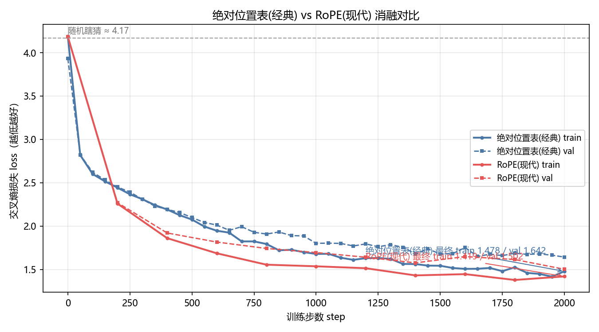
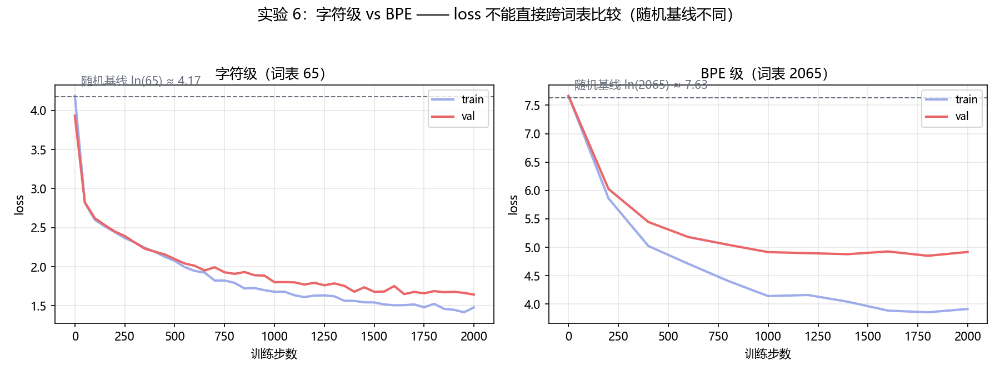
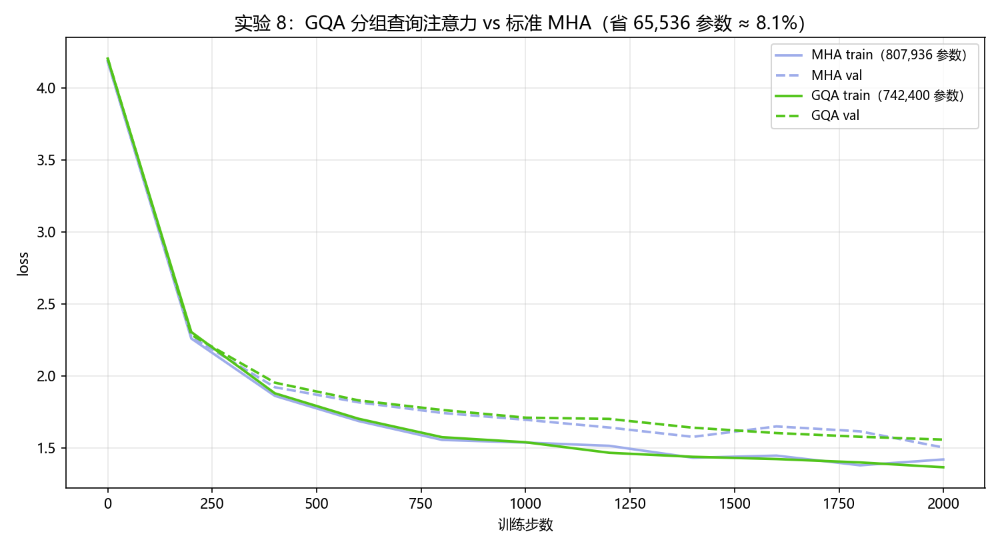

# llm-internals · 从零手写迷你 GPT（理解大模型底层原理）

> 不调用任何外部 AI API，在普通个人电脑上从零训练一个 **74 万~82 万参数**的字符级 GPT。
> 读懂它，就摸到了大模型的核心门道：**数据 → 模型 → 权重自动学习 → 生成**。

纯 Python ｜ PyTorch ｜ ~80 万参数（GQA 版 742,400）｜ 2000 步可复现 ｜ MIT License

---

## 面试速览（简历可直接引用）

**一句话版（项目经历首行）：**

> **从零手写大模型底层（llm-internals）** —— 不使用任何现成框架/API，用 PyTorch 从零实现并训练字符级迷你 GPT（~80 万参数），完整覆盖 Transformer 全链路，并逐个复现现代大模型关键优化：SwiGLU、RoPE 旋转位置编码、BPE 分词、KV Cache、GQA 分组查询注意力。

**展开段（2~3 行）：**

> 共完成 8 组对照实验，每组都固定随机种子、同配置公平对比并产出可复现数据：SwiGLU 比 GELU val loss −0.07；RoPE 位置编码支持上下文外推；BPE 分词词表 65→2,065；KV Cache 推理加速 2.08×（结果逐字一致）；GQA 分组查询注意力参数 −8.1%、KV 缓存减半、val loss 仅 +3.6%。全部代码带教学级中文注释，复现命令一条可跑。

**被问"GQA 为什么值钱"时的一句话回答：**

> 相邻注意力头学到的模式高度相似，让它们共享 K/V 组：参数省 8%，KV 缓存减半——省下的显存去换更长的上下文或更大的 batch，收益远超 3.6% 的 loss 代价。这就是 Llama 2/3 和 Mistral 都选它的原因。验证方式：同 seed 同配置训练 2000 步对比 + KV Cache 逐字一致性验证，日志全在仓库。

---

## 项目简介

本项目用 PyTorch **从零实现并训练**了一个字符级 GPT（生成式预训练 Transformer），全部核心组件手写，无任何现成 Transformer 库：

- **数据**：莎士比亚全集（1.1MB 纯文本，约 65,000 种字符片段，词表 65）
- **规模**：65 字符词表 × 128 维嵌入 × 4 层 × 4 注意力头
- **结果**：2000 步训练后 **train loss 1.48 / val loss 1.64**，可生成莎士比亚腔文本
- **成本**：普通个人电脑 CPU 训练约 15 分钟，零成本

模型学到的本质是"字符之间的统计规律"——什么字符经常挨着、什么词语常出现、什么句式像莎翁。**这就是大模型语言能力的最小可复现版本**，原理与 GPT-4 / DeepSeek 等大模型完全一致，只是规模放大了千万倍。

## 亮点

| 亮点 | 说明 |
|---|---|
| **从零手写** | 不使用 HuggingFace、不调 API，每个组件可逐行读 |
| **双激活可切换** | MLP 支持 GELU（经典）与 SwiGLU（现代大模型），`--activation` 一键对比 |
| **GQA 可切换** | 注意力支持标准 MHA 与 GQA（K/V 头共享，Llama 2/3 同款），`--n_kv_head` 一键对比 |
| **教学级注释** | model.py 每行中文注释，注释即教程 |
| **可复现** | 固定随机种子（1337），2000 步结果可精确复现 |
| **参数透视** | peek_weights.py 可查看训练前后权重变化 |
| **万物可学** | 换任意 .txt 语料即可重训（中文也支持） |

## 模型架构

```
输入字符序列 "ROMEO:"
        │
        ▼
┌──────────────────────────────────┐
│  字符嵌入表 65×128               │
│  + 位置嵌入表 128×128            │
└──────────────────────────────────┘
        │  x (B, T, 128)
        ▼
┌──────────────────────────────────┐
│  Block × 4 层                    │
│  ┌────────────────────────────┐ │
│  │ LayerNorm → 多头因果注意力   │ │
│  │      ↓ 残差连接 (+)         │ │
│  │ LayerNorm → MLP（GELU）     │ │
│  │      ↓ 残差连接 (+)         │ │
│  └────────────────────────────┘ │
└──────────────────────────────────┘
        │
        ▼
  LayerNorm → 输出头 (128→65)
        │
        ▼
  65 个字符的分数 → softmax → 预测下一个字符
```

### 参数构成（82 万 = 查表 + 接线板 + 旋钮）

| 模块 | 参数量 | 类比 |
|---|---:|---|
| 字符嵌入表（65×128） | 8,320 | 字符"长什么样" |
| 位置嵌入表（128×128） | 16,384 | 位置"长什么样" |
| 4 × Block（注意力 + MLP + 归一化） | 791,040 | "谁和谁挨着"的接线板 |
| 输出归一化 + 输出头 | 8,576 | 出口微调 + 打分 |
| **合计** | **824,320** | **≈ 82 万** |

### 核心组件（全部手写）

- **多头因果注意力**：字符间"横向交流"——只看左边，QKV 打分 → 掩码 → 概率 → 加权求和
- **LayerNorm**：归一化（减均值除标准差）+ 可学习的 γ/β 旋钮
- **残差连接**：信息抄近路 + 梯度回城高速，让深层网络可训练
- **MLP（GELU 激活）**：每个字符"纵向思考"，非线性让多层不白叠
- **温度采样**：推理时控制随机性（低=保守复读，高=胡言乱语）

## 训练效果

- 训练 2000 步：**train loss 1.4785 / val loss 1.6424**（实测，约 15 分钟）
- loss 含义：1.48 ≈ 平均每次预测有 23% 把握猜对下一个字符（随机瞎猜是 ln(65)≈4.17，即 1/65 概率）
- 生成效果：模型输出莎士比亚剧本风格文本（含角色名、对白分行）


> 曲线解读：train/val loss 从随机水平（≈4.17）一路下降——模型确实在学"字符规律"，不是背答案。

## 快速上手

```bash
# 1. 安装依赖（只需 PyTorch）
pip install torch

# 2. 训练（默认 2000 步，CPU 约 15 分钟）
python train.py

# 3. 生成一段文本（默认从 "ROMEO:" 开始）
python generate.py

# 4. 自定义生成
python generate.py --prompt "To be, or not" --length 300 --temperature 0.8
```

### 常用参数

**训练** `python train.py`

| 参数 | 说明 |
|---|---|
| `--max_iters 5000` | 训练更多步（更慢但效果更好） |
| `--n_layer 8` | 加深层数（权重的"层数"） |
| `--lr 3e-4` | 学习率 |
| `--activation swiglu` | 切换 MLP 激活函数（gelu 经典 / swiglu 现代大模型版） |
| `--log loss_log.csv` | 记录训练 loss 日志（`plot_loss.py` 画图用） |
| `--print_weights` | 训练完打印每一层权重张量 |

**生成** `python generate.py`

| 参数 | 说明 |
|---|---|
| `--prompt "..."` | 开头文字 |
| `--length 500` | 生成长度 |
| `--temperature 0.1` | 稳定 ／ `0.8` 适中 ／ `1.5` 疯狂 |

### 换个语料训练

把任意 `.txt` 文件复制为 `input.txt`（UTF-8 编码），重新运行 `python train.py` 即可 —— 这就是"万物皆可量化 / 万物皆可学"的第一步。

## 项目结构

```
llm-internals/
├── model.py          # 模型定义（教学级中文注释，注释即教程）
├── train.py          # 训练脚本：喂数据 → 自动学权重 → 保存模型（支持 --log 记录 loss）
├── generate.py       # 推理脚本：用训练好的模型生成文本
├── plot_loss.py      # 画图脚本：把训练日志画成 loss 曲线
├── peek_weights.py   # 透视脚本：查看训练前后权重变化
├── rope_extrapolation.py  # 实验5：RoPE 外推 + NTK 验证脚本
├── tokenizer.py       # 实验6：BPE 分词器（训练/编码/解码，GPT-2 同款思路）
├── compare_bpe.py     # 实验6：字符级 vs BPE 生成对比 + loss 对比图
├── bpe_demo.py        # 实验6：BPE 合并过程演示（小数据版）
├── kv_cache_demo.py   # 实验7：KV Cache 推理加速对比（无缓存 vs 缓存）
├── gqa_compare.py     # 实验8：GQA vs 标准 MHA 的 loss 对比图
├── input.txt         # 训练语料（莎士比亚全集，1.1MB）
├── model.pt          # 训练好的权重（824,320 参数）
├── loss_log.csv      # 训练日志（step/train loss/val loss，画图用）
├── run_generate.bat  # Windows 一键生成（双击即可）
├── assets/           # README 配图（loss 曲线等）
├── 代码阅读指南.md    # 新手向的代码阅读指南
└── README.md         # 项目说明（本文件）
```

## 实验记录

> 持续更新中 —— 七个实验的进行状态：

- [x] **loss 曲线可视化**：`python train.py --log loss_log.csv --eval_interval 50` 记录日志 → `python plot_loss.py` 画图（见上方训练效果图）
- [x] **GELU vs SwiGLU 消融实验**：两版各训 2000 步，参数量基本持平（821,248 vs 824,320，差 0.4%），对比结论见下
- [x] **训练前后生成效果对比**：随机模型 vs 训练后模型（见下，完整文本在 `assets/before_train.txt` / `assets/after_train.txt`）
- [x] **学习率调度实验**：固定学习率 vs warmup+余弦退火，三版各训 2000 步，验证"调度威力在长训练"（见下）
- [x] **RoPE 位置编码升级实验**：绝对位置表 vs RoPE（现代大模型同款）对比 + NTK 外推验证（见下）
- [x] **BPE 分词器升级实验**：字符级 vs BPE（GPT-2 同款 tokenizer）对比，词表 65 → 2,065（见下）
- [x] **KV Cache 推理加速实验**：无缓存 vs KV Cache 生成对比，结果逐字一致 + 加速比随长度增长（见下）
- [x] **GQA 分组查询注意力实验**：K/V 头减半共享（4 Q 头 ↔ 2 K/V 组），省 8.1% 参数、KV 缓存小一半（见下）

### 实验 2：GELU vs SwiGLU 消融


| 版本 | 最终 train loss | 最终 val loss |
|---|---:|---:|
| GELU（经典，GPT-2/3） | 1.478 | 1.642 |
| **SwiGLU（现代，Llama/DeepSeek）** | **1.358** | **1.576** |

**结论**：在参数量基本持平（差 0.4%）的公平对比下，SwiGLU 训练与验证 loss 均更低（train −0.12，val −0.07），与业界"现代大模型选用 SwiGLU"的结论一致——门控结构让模型能自己学习"放多少信息通过"，表达力更强。

复现方法：
```bash
python train.py --log loss_log.csv          --save model.pt        # GELU 版
python train.py --activation swiglu --log loss_log_swiglu.csv --save model_swiglu.pt  # SwiGLU 版
python plot_loss.py --log loss_log.csv --log2 loss_log_swiglu.csv --name1 GELU --name2 SwiGLU --out assets/loss_compare.png
```

### 实验 3：训练前后生成效果对比

同一句话开头（`ROMEO:`）、同一种子、同一温度（0.8），生成 300 字符：

**训练前（随机初始化模型）—— 纯乱码：**
```
ROMEO:CpzlYaS ;czde.'wEiT,YVrzlGu-aYeNY
ijbo
LzRX$KULS-A.U'FisVJ'G HT,OPtW;,Ye$zOAnsz-imHzPAkfEfY:gS;RTNBE:myOzx. qVh -LLcJJlOHPXBvsLAofgSn
KqzMdXEIAgqgpoZvhA&Xn3z;SKGSqIaqvWr
...
```

**训练后（2000 步）—— 莎士比亚腔：**
```
ROMEO:
Why, hercheed we hence, sunse heart
That answer-body is bid with this base nothing cold
And hath ansmy more shall collowem's profe?

KING HENRY VI:
Marry paise to a virtuous to the perfort:
My little have the shing hearting her hate;
...
```

**结论**：训练前权重是随机数，模型"什么都不知道"，输出纯乱码；训练 2000 步后，82 万权重里存下了"什么字符经常挨着"的统计规律——有角色名、有对白分行、句子半通不通。**这就是大模型语言能力的诞生过程**。

复现方法：`python before_after_demo.py`（完整文本存于 `assets/before_train.txt` / `assets/after_train.txt`）

### 实验 4：学习率调度（warmup + 余弦退火）对比


同一个模型、同一份数据、同样的 2000 步，三种学习率策略：

| 策略 | 最终 train loss | 最终 val loss |
|---|---:|---:|
| 固定学习率（3e-4 全程） | 1.478 | **1.642** |
| warmup + 退火到 0（第一版） | 1.615 | 1.726 |
| warmup + 退火到 lr/10（改进版） | 1.586 | 1.701 |

**结论**（这个结论不是书上抄的，是三组真实训练数据跑出来的）：
- **退火不该退到 0**：退到 0 意味着后期学习率趋近于 0，模型完全停止学习，白白浪费步数（第一版 val 1.726 最差）；退到峰值的 1/10 明显更好（1.701）。
- **2000 步的小短跑里，固定学习率仍然略胜**：全程满速 3e-4 大踏步，在短训练里占便宜。
- **但改进版曲线末期没有饱和**（val 从 1.733 一路缓降到 1.701），固定版后期已经趋平震荡——**只要训练够长，学习率调度会翻盘**。这正是 GPT/Llama/DeepSeek 等大模型（动辄几万步）全部使用学习率调度的原因：**调度的威力在长训练才释放**。

复现方法：
```bash
python train.py --log loss_log.csv --save model.pt            # 固定学习率（旧）
python train.py --log loss_log_sched.csv --save model_sched.pt   # 第一版：退火到 0
python train.py --log loss_log_sched2.csv --save model_sched2.pt # 改进版：退火到 lr/10
python plot_loss.py --log loss_log.csv --log2 loss_log_sched2.csv --name1 "固定学习率" --name2 "退火到lr/10" --out assets/loss_sched2_compare.png
```

### 实验 5：RoPE 位置编码升级 + NTK 外推验证



**背景**：位置编码有两种主流方案——
- **绝对位置表**（GPT-2 经典）：给每个位置一个可学习向量，"查表"式。位置信息靠"加法"注入。
- **RoPE 旋转位置编码**（Llama/DeepSeek/Qwen 现代大模型）：把 Q/K 向量按位置"旋转一个角度"，位置写进向量的方向里。公式 `θ = base^(-2i/d)`，**0 个可学习参数**；点积只看相对距离，天然能外推到训练时没见过的新位置。

**训练对比（各 2000 步，其他配置完全相同）**：

| 版本 | 参数量 | 最终 train loss | 最终 val loss |
|---|---|---:|---:|
| 绝对位置表（GPT-2 经典） | 824,320 | 1.478 | 1.642 |
| **RoPE（现代大模型同款）** | **807,936** | **1.419** | **1.502** |

**结论 1**：RoPE 省掉了位置表（少 16,384 参数），且验证 loss 全面更低（1.502 vs 1.642）——"现代大模型为什么都换 RoPE"有数据支撑。

**外推验证**（训练时上下文 128，推理时一次性输入 256 字符，即 2 倍训练长度）：

| 方案 | 256 字符 loss |
|---|---:|
| 随机基线（瞎猜 65 个字符） | 4.174 |
| 裸 RoPE 直接外推 | 1.435 |
| **NTK-aware 缩放（只换频率表，模型参数不动）** | **1.256** |
| 改 base 训练（Qwen 式，base 10,000→20,946） | 1.504 |

**结论 2**：
- **RoPE 能外推到 2 倍训练长度**（loss 仍远低于随机基线）；绝对位置表做不到——位置表只有 128 行，查不到新位置，直接报错。
- **NTK-aware 缩放进一步改善外推**（1.435 → 1.256）：把"超出训练范围的旋转角度"压回模型熟悉的范围内，模型参数一个不动，只重算频率表。这正是 Qwen 训练时把 base 从 10,000 调到 100 万、DeepSeek 用 YaRN 做长上下文的技术基础。

复现方法：
```bash
# 训练对比
python train.py --pos_enc rope --save model_rope.pt --log loss_log_rope.csv
python plot_loss.py --log loss_log.csv --log2 loss_log_rope.csv --name1 "绝对位置表" --name2 "RoPE" --out assets/loss_rope_compare.png
# 外推验证
python rope_extrapolation.py --model model_rope.pt --extrap_len 256              # 裸 RoPE 外推
python rope_extrapolation.py --model model_rope.pt --extrap_len 256 --ntk        # NTK 换表外推
```

### 实验 6：BPE 分词器升级（GPT-2 同款 tokenizer）



**背景**：之前一直是"字符级"——1 个字符 = 1 个 token。问题：数据里 "the" 出现几万次，模型每次都要从 `t`、`h`、`e` 重新拼；128 的上下文窗口只能看 128 个字符。

**BPE（字节对编码）思路**：反复合并"出现次数最多的相邻对"，让 `th`、`the␣`、`you` 这种高频片段变成单个 token。**它是纯数据驱动的**——莎士比亚数据自动长出了 `.\n\nQUEEN MARGARET:\n`（完整台词切换块）、`Montagu`（人名）这种 token。

| 项目 | 字符级 | BPE 级 |
|---|---:|---:|
| 词表大小 | 65 | 2,065 |
| 数据表示 | 1,115,394 字符 | 349,135 token（**压缩 3.2 倍**） |
| 参数量 | 807,936 | 1,319,936 |
| 随机基线（瞎猜）loss | ln(65) ≈ 4.17 | ln(2065) ≈ 7.63 |
| 最终 val loss | 1.502 | 4.917 |
| **换算成"每字符成本"** | **1.50 bits/char** | **4.917 ÷ 3.2 ≈ 1.54 bits/char** |

**结论 1（重要的知识点）**：**loss 不能跨词表直接比**——词表越大，随机猜对的概率越低，随机基线越高（`ln(词表大小)`）。换算成"每字符成本"后两者几乎相当（1.50 vs 1.54），说明同样 2000 步学到的"信息量"一样多。

**结论 2（BPE 的真正价值）**：
- **有效上下文 ×3.2**：128 token 窗口 = 约 410 字符，模型能"记住"更长的剧情
- **生成更连贯**：同 seed、同温度对比，BPE 版角色名齐全（LADY CAPULET / POLIXENES / MENENIUS）、台词结构完整，字符级只能蹦短语
- **学习单元更大**：1 个 token 是一个片段/词，模型不用再学"拼字"

**生成对比（同 seed、同温度 0.8、300 token）**：
- **字符级**：`ROMEO: Have his wife? fear. ANGELO: The bitter, that hope! Well, as you shine crave we the hopes...`
- **BPE 级**：`ROMEO: OF SLY: A fares and that What, hares my sir, They have with country's mighty writ... LADY CAPULET: A John, I shall make rather sweet hearts.`

复现方法：
```bash
python tokenizer.py                       # 训练 BPE 分词器（词表 2065，保存 bpe_tokenizer.pkl）
python train.py --tokenizer bpe --pos_enc rope --save model_bpe.pt --log loss_log_bpe.csv  # 训练 BPE 版
python compare_bpe.py                     # 生成对比 + loss 对比图
```

### 实验 7：KV Cache 推理加速（所有大模型推理都在用的优化）

**背景**：朴素生成每生成 1 个新 token，都把整个序列重新过一遍模型——历史位置的 K/V 每次都重算，第 N 步白白重算 N-1 份。生成 120 token 就是 1+2+...+120 ≈ 7,260 份位置计算，99% 是重复劳动。

**思路**（用显存换时间）：
- **预填充（prefill）**：prompt 一次过完，每层把 K/V 存进缓存
- **增量生成**：每步只输入"刚生成的新 token"，算出它的 K/V 拼进缓存尾巴，注意力直接拿"全部历史 K/V"用——旧位置零重算

**实现**：`model.py` 的注意力 forward 增加可选参数 `layer_cache`（存 K/V）和 `pos_offset`（新位置的真实位置，RoPE 旋转角按它取）；新增 `GPT.generate_cached()`。默认参数不变，旧模型文件照常加载。

**正确性验证（关键）**：同随机种子跑朴素版和 Cache 版，**生成结果必须逐字一致**——缓存只是省重复计算，不能改变任何数学结果。

**性能对比**（CPU，RoPE 版模型，RoMEO 版，温度 0.8，结果全部逐字一致 ✅）：

| 生成长度 | 朴素版耗时 | KV Cache 版耗时 | 加速比 |
|---|---:|---:|---:|
| 40 token | 146 ms | 105 ms | 1.39 × |
| 80 token | 359 ms | 195 ms | 1.84 × |
| 120 token | 622 ms | 299 ms | **2.08 ×** |

**结论：生成越长，加速越明显**——朴素版每步重算的位置随长度线性增长，缓存版恒定只算 1 个位置。

**为什么只快 2 倍而不是 60 倍？**（重要的工程认知）理论省 60 倍计算量，但实际瓶颈是：①模型太小（4 层 128 维，注意力占比低）；②Python 循环调度和 `torch.cat` 拼接开销省不掉；③CPU 上小张量运算调度成本高。真实大模型（几十层、长上下文、GPU 上矩阵运算占主导）的 KV Cache 收益是 10~100 倍——这也是 ChatGPT / DeepSeek 推理的标配。

**踩过的坑（真实工程教训）**：第一版实现"每步输入 prompt 的最后一个字符"，但它的 K/V 预填充时已缓存——缓存出现重复位置，结果逐字不一致。正确做法：预填充时直接用最后位置的分数采样第一个新 token，循环只输入"刚生成、还没进缓存"的新 token。

复现方法：
```bash
python kv_cache_demo.py --model model_rope.pt --length 120
```

### 实验 8：GQA 分组查询注意力（Llama 2/3 同款，省显存的关键）

**背景**：标准多头注意力（MHA）里每个 Q 头都有自己独立的 K/V 头——4 个 Q 头配 4 组 K/V。但研究发现：**相邻的 Q 头关注的模式很相似**，没必要各自存一份 K/V。GQA 的做法：Q 头保持 4 组不变，K/V 头减半为 2 组，每组 K/V 服务 2 个 Q 头（代码里就是一行 `k.repeat_interleave(2, dim=1)` 复制共享）。



**参数账**（n_embd=128、n_head=4、n_kv_head=2、4 层）：

| 版本 | c_attn 输出维 | 每层 c_attn 权重 | 总参数量 | 相对 |
|---|---:|---:|---:|---:|
| MHA（实验5 RoPE 版） | Q128+K128+V128=384 | 128×384 | 807,936 | 100% |
| **GQA（本实验）** | Q128+K64+V64=**256** | 128×256 | **742,400** | **−8.1%** |

省下 65,536 个参数，同时**推理时 KV 缓存也小一半**（K/V 只有 2 组而非 4 组）——长上下文场景显存翻倍的重要来源。

**训练对比**（同 seed、同配置、同样 2000 步，唯一变量 = n_kv_head 4→2）：

| 版本 | 最终 train loss | 最终 val loss |
|---|---:|---:|
| MHA | 1.4190 | **1.5021** |
| GQA | **1.3646** | 1.5567 |

**结论**：GQA 用 8.1% 的参数换来 val loss 只涨 0.055（约 3.6%）——这个"小代价换大显存"的交易就是 Llama 2/3、Mistral 都选 GQA 的原因：省下的 KV 缓存可以去换更长的上下文或更大的 batch，收益远超这点损失。图中 GQA 的 train loss 反而更低，也符合直觉：K/V 共享相当于一种参数约束，小数据上更不容易"背"训练集。

**与实验 7 联动**：KV Cache 在 GQA 模型上依然逐字一致 ✅（加速比 2.13×），且缓存张量天然小一半——GQA 是 KV Cache 的"最佳搭档"。

**踩过的坑（真实工程教训）**：GQA 的 K 只有一半头，从 `qkv.split()` 出来的切片视图在 `transpose` 后内存不连续，RoPE 里的 `view` 直接报错 `view size is not compatible`——改成 `reshape`（非连续时自动安全拷贝）解决。教训：**split/transpose 之后别用 view 改形状**。

复现方法：
```bash
python train.py --pos_enc rope --n_kv_head 2 --save model_gqa.pt --log loss_log_gqa.csv  # 训练 GQA 版
python gqa_compare.py   # 生成对比图 + 打印双方最终 loss
python kv_cache_demo.py --model model_gqa.pt --length 120  # GQA 上验证 KV Cache
```

## 本项目 vs 真正的大模型

| | 本项目 | GPT-4 级别大模型 |
|---|---|---|
| 参数量 | ~82 万 | ~1 万亿 |
| 训练数据 | 1.1MB | 整个互联网 |
| 训练时间 | 几分钟~15 分钟 | 数万张显卡跑数月 |
| 训练成本 | 0 元 | 数亿美金 |

原理、代码结构完全一样，只是规模放大了千万倍。

## License

MIT License
